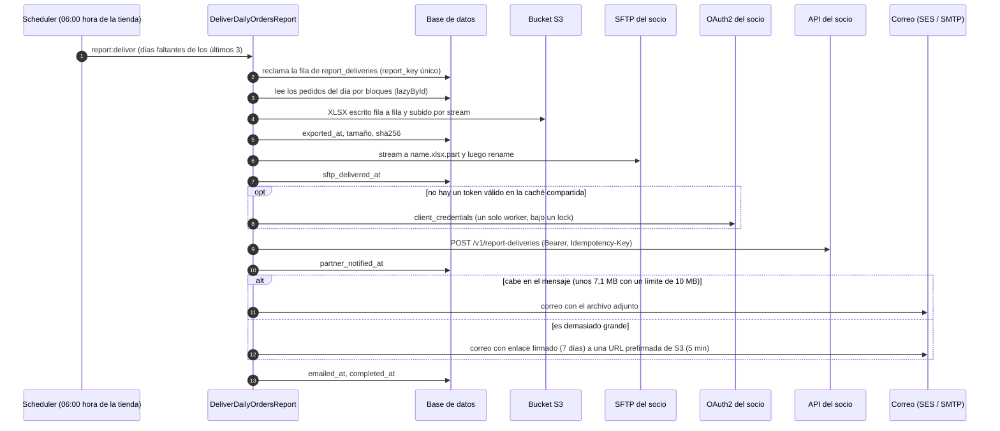

# Laravel Integrations Kit

[English](README.md) · **Español**

[](https://github.com/JulianContreras02/laravel-integrations-kit/actions/workflows/ci.yml)

Un proyecto pequeño y terminado en Laravel 13 con las integraciones que casi todo sistema de negocio termina necesitando:
- un cliente de API con OAuth2 que aguanta la concurrencia;
- una exportación grande a Excel que nunca se carga entera en memoria;
- una entrega por SFTP que se puede reintentar sin riesgo;
- un correo que sabe cuándo un archivo es demasiado grande para adjuntarlo.

Todo corre contra servicios simulados en Docker Compose. No hace falta ninguna cuenta real.

![Grabación de terminal de una ejecución real: report:deliver entrega tres días hábiles mientras el registro de WireMock cuenta una sola petición de token OAuth; los tres archivos aparecen en la bandeja SFTP del socio sin ningún .part; el servidor SFTP empieza a rechazar escrituras y la entrega falla tras reintentos con backoff; cuando vuelve a aceptarlas, el reintento sigue en el paso de SFTP y reutiliza la exportación anterior (dos intentos en report:status); una última ejecución ya no tiene nada que entregar.](docs/demo/demo.gif)

<sub>Una ejecución real contra la pila de Docker Compose, grabada con VHS a partir de [`docs/demo/demo.tape`](docs/demo/demo.tape) (ver [Grabar la demo](#grabar-la-demo)).</sub>

## El problema

Una tienda en línea tiene que enviarle cada mañana a su operador logístico el reporte de los pedidos del día anterior. El socio pide:

1. Un **archivo de Excel** en su bandeja **SFTP**.
2. Una llamada a su **API REST**, protegida con **OAuth2 client credentials**, que registre el archivo y su SHA-256.
3. Un **correo** a su buzón de operaciones con el archivo, o con un enlace de descarga si el archivo es muy grande.

Parece sencillo hasta que aparecen los casos de falla:

- Muchos workers piden un token OAuth en el mismo instante.
- Un día de mucho movimiento no cabe en memoria.
- El servidor SFTP corta la conexión a mitad de una subida.
- Un reintento manda el mismo archivo dos veces.
- El proveedor de correo rechaza un adjunto de 12 MB.
- El programador de tareas estuvo caído todo el fin de semana.

Este repositorio resuelve cada uno de esos casos y tiene un test para cada uno.

## Qué muestra

| Pieza | Cómo | Código |
|---|---|---|
| OAuth2 client credentials | El token vive en una caché compartida hasta `expires_in − 60 s`. La renovación ocurre bajo un lock atómico con una segunda revisión de la caché, así que diez workers hacen una sola petición de token. Ante un 401, el cliente descarta ese token y reintenta exactamente una vez. | [`ClientCredentialsTokenProvider`](app/Integrations/Partner/OAuth/ClientCredentialsTokenProvider.php), [`PartnerApiClient`](app/Integrations/Partner/PartnerApiClient.php) |
| Excel grande a S3 | Las filas se leen con paginación por clave (keyset) y se escriben una a una con OpenSpout. Luego el archivo se sube a S3 por stream. Usa la misma memoria con 1.000 que con 1.000.000 de pedidos. | [`DailyOrdersExporter`](app/Reports/DailyOrdersExporter.php) |
| SFTP con reintentos e idempotencia | Sube a `name.part` y luego renombra. Si el archivo ya está con el mismo tamaño, no hace nada. Un archivo distinto con el mismo nombre es un error y nunca se sobrescribe. Los reintentos cortos dentro del proceso cubren los cortes de red; los de la cola cubren las caídas largas. | [`SftpDelivery`](app/Delivery/SftpDelivery.php) |
| Correo según el tamaño | Calcula el tamaño exacto en base64 MIME frente al límite de SES. Si lo supera, el correo lleva un enlace firmado de Laravel en lugar del archivo. El enlace redirige a una URL prefirmada de S3 que dura 5 minutos. | [`AttachmentPolicy`](app/Mail/AttachmentPolicy.php), [`ReportMailer`](app/Mail/ReportMailer.php), [`DownloadReportController`](app/Http/Controllers/DownloadReportController.php) |
| Orquestación | Un job en cola por cada día hábil. Cada paso queda registrado en una tabla de control, así que un reintento sigue donde se quedó el intento anterior. Una ventana de recuperación rescata los días que faltaron. | [`DeliverDailyOrdersReport`](app/Jobs/DeliverDailyOrdersReport.php), [`report:deliver`](app/Console/Commands/DeliverDailyOrdersReportCommand.php) |

## Flujo



Si un paso falla, la cola reintenta el job más tarde: a los 1, 5 y 15 minutos. El reintento se salta todos los pasos que ya tienen marca de tiempo, así que trabaja sobre el mismo archivo con el mismo checksum.

## Cómo ejecutarlo

Solo necesitas Docker con Compose. No hace falta PHP en tu máquina.

```bash
git clone https://github.com/JulianContreras02/laravel-integrations-kit.git
cd laravel-integrations-kit
cp .env.example .env
```

Instala las dependencias, genera la llave y crea la base de datos:

```bash
docker compose run --rm app sh -c "composer install && composer setup"
```

Levanta la app, el worker de la cola y los servicios simulados:

```bash
docker compose up -d --wait
```

Carga tres días de pedidos de prueba y entrégalos:

```bash
docker compose exec app php artisan db:seed
```

```bash
docker compose exec app php artisan report:deliver --sync
```

Sin `--date`, `report:deliver` entrega todos los días de los últimos tres que aún no se han entregado. Con `--sync` corre en el proceso actual; sin esa opción, los jobs van al worker de la cola.

### Qué revisar

| Dónde | Qué deberías ver |
|---|---|
| `docker compose exec app php artisan report:status` | Una fila por día, con la hora en que terminó cada paso |
| Mailpit, <http://localhost:8025> | Tres correos con la hoja de cálculo adjunta |
| Consola de RustFS, <http://localhost:9001> (`local-access-key` / `local-secret-key`) | Los archivos en `reports/daily-orders/YYYY/MM/` |
| `docker compose exec sftp ls -l /home/partner/inbound` | Los mismos tres archivos, sin ningún `.part` |
| WireMock, <http://localhost:8080/__admin/requests> | **Una** petición de token, y luego un registro por día con su `Idempotency-Key` |

### Prueba los casos de falla

**Volver a ejecutarlo no cambia nada:**

```bash
docker compose exec app php artisan report:deliver --sync
```

**Un archivo demasiado grande para adjuntar.** Baja el límite para una sola ejecución y elige cualquier día pasado:

```bash
docker compose exec -e REPORT_MAIL_MAX_MESSAGE_BYTES=1 app php artisan report:deliver --date=2026-01-15 --sync
```

El correo en Mailpit ahora trae un botón "Download the report" en lugar del adjunto. El enlace va a la app en el puerto 8000, que redirige a una URL prefirmada en el puerto 9000. Si cambias un solo carácter del enlace, obtienes un 403.

Un día grande de verdad hace lo mismo con el límite por defecto de 10 MB. Con 300.000 pedidos, el archivo de 12,2 MB viaja como enlace y el correo completo pesa 12,5 kB:


**Se cae el servidor SFTP del socio.** Detenlo y encola un día:

```bash
docker compose stop sftp
```

```bash
docker compose exec app php artisan report:deliver --date=2026-01-16
```

Más o menos al minuto, `report:status` muestra el día exportado pero no entregado, con el error. Vuelve a encender el servidor:

```bash
docker compose start sftp
```

La cola reintenta el job 60 segundos después de la falla. Se salta la exportación (el mismo `exported_at` y el mismo checksum) y termina los pasos que faltan. Puedes seguirlo con `docker compose logs -f worker`.

¿Algún puerto ya está ocupado? Cambia `APP_PORT`, `S3_PORT`, `MAILPIT_PORT` y los demás en `.env`, y ajusta `APP_URL` y `AWS_PUBLIC_ENDPOINT` para que coincidan.

### Grabar la demo

El GIF del inicio se graba con [VHS](https://github.com/charmbracelet/vhs) a partir de [`docs/demo/demo.tape`](docs/demo/demo.tape). La cinta escribe los mismos comandos `docker compose exec` de este README contra la pila en ejecución, después de que [`prepare.sh`](docs/demo/prepare.sh) la deja en un estado conocido. Con la pila arriba, desde la raíz del repositorio:

```bash
docker build -t integrations-kit-vhs docs/demo
```

```bash
docker run --rm -v /var/run/docker.sock:/var/run/docker.sock -v "$PWD:/vhs" integrations-kit-vhs docs/demo/demo.tape
```

Después, [`mailpit-screenshot.sh`](docs/demo/mailpit-screenshot.sh) entrega el día de 300.000 pedidos y toma la captura de Mailpit con el Chromium de la misma imagen.

## Tests

| Suite | Comando | Qué necesita |
|---|---|---|
| Unitarios y de feature (76 tests) | `docker compose run --rm --no-deps app composer test` | Nada: HTTP, almacenamiento, correo y cola están simulados |
| Integración (10 tests) | `docker compose exec app composer test:integration` | Los servicios de compose en ejecución |
| Lint y análisis estático | `docker compose run --rm --no-deps app composer lint`, y luego `composer analyse` | Nada |

Si tienes PHP 8.4+ y Composer instalados, `composer install && composer check` corre el lint, el análisis y la suite normal.

Algunos tests vale la pena leerlos por separado:

- [**Concurrencia con procesos reales**](tests/Feature/Partner/TokenRefreshConcurrencyTest.php): diez procesos `php artisan partner:token` arrancan a la vez, con la caché de archivos vacía, contra un servidor de tokens local que responde lento a propósito. El servidor debe haber emitido exactamente un token. Si se quita el lock, el mismo test ve diez.
- [**Memoria en el peor caso**](tests/Feature/Reports/DailyOrdersExportMemoryTest.php): exportar 40.000 pedidos no puede usar más memoria que exportar 2.000. Ambos llegan a un pico de alrededor de 1,1 MB. Si las filas se cargan con `get()`, la exportación grande sube a 43 MB y el test falla.
- [**Tamaño MIME exacto**](tests/Unit/AttachmentPolicyTest.php): la fórmula del tamaño se comprueba contra `chunk_split(base64_encode(...))`.
- [**Reanudar tras una falla**](tests/Feature/Reports/DeliverDailyOrdersReportTest.php): el SFTP falla y luego vuelve. El reintento reutiliza la exportación (misma marca de tiempo y mismo checksum) en lugar de generarla de nuevo.
- [**Integración**](tests/Integration): el conteo real de tokens en WireMock, un token revocado simulado con un escenario de WireMock, URLs prefirmadas validadas por RustFS, el servidor SFTP real, SMTP hacia Mailpit y el job completo ejecutado dos veces para un mismo día.

En cada push y cada pull request, el CI corre:
- Pint y Larastan en nivel max;
- la suite en PHP 8.4 y 8.5, con al menos 90 % de cobertura (hoy está en 98 %);
- el grupo de integración contra los mismos servicios de Docker Compose.

## Volumen de peor caso

Antes de confiar en una exportación en producción, pruébala con el peor día que esperas. `report:benchmark` llena una base de datos desechable en memoria con pedidos sintéticos, exporta cada volumen al bucket real y limpia todo al terminar:

```bash
docker compose exec app php artisan report:benchmark --rows=1000,10000,100000,300000,1000000
```

En Docker Desktop (Windows), con RustFS como S3:

| Pedidos | Exportación y subida | Pico de memoria de PHP | Usada por la exportación | Tamaño del archivo | Correo |
|---:|---:|---:|---:|---:|---|
| 1.000 | 0,1 s | 51,1 MB | 1,2 MB | 0,05 MB | adjunto |
| 10.000 | 0,4 s | 51,5 MB | 1,1 MB | 0,43 MB | adjunto |
| 100.000 | 4,4 s | 54,3 MB | 2,1 MB | 4,36 MB | adjunto |
| 300.000 | 18,5 s | 54,3 MB | 2,1 MB | 12,21 MB | enlace firmado |
| 1.000.000 | 108,3 s | 55,2 MB | 3,0 MB | 39,65 MB | enlace firmado |

"Usada por la exportación" es el pico por encima de la base del proceso, que es el framework ya cargado. Se queda en unos pocos megabytes desde 1.000 hasta 1.000.000 de filas. Alrededor de los 170.000 pedidos el archivo supera el presupuesto para adjuntos y el correo pasa solo al enlace.

La base de datos es SQLite en memoria, así que la columna de tiempo es un mínimo. Contra un MySQL en red, las lecturas tardan más; la memoria y el tamaño del archivo no cambian.

## Decisiones de diseño y sus costos

**Caché del token con lock y segunda revisión, no solo una caché.** Una caché sola todavía deja que todos los workers renueven a la vez cuando el token vence (un *cache stampede*). Con el lock, un worker renueva mientras los demás lo esperan y luego leen el token nuevo.
- El TTL del lock (15 s) es mayor que el timeout de la petición de token (5 s), así que una renovación lenta nunca se duplica.
- Los workers que esperan se rinden a los 10 s y dejan que la cola reintente, en lugar de amontonarse.
- Ante un 401, el cliente descarta el token solo si la caché todavía tiene ese mismo token. Así, un 401 tardío no puede borrar un token que otro worker acaba de renovar.
- *Costo:* el almacén de caché debe soportar locks atómicos y estar compartido entre todos los workers. Una caché de archivos sirve en un solo servidor. Con varios servidores, o en Lambda, hace falta Redis o DynamoDB.

**OpenSpout, no Laravel Excel.** Laravel Excel está construido sobre PhpSpreadsheet, que mantiene en memoria un objeto por cada celda, así que la memoria crece con el número de filas. OpenSpout escribe las filas a disco a medida que llegan, con cadenas en línea, así que tampoco crece en memoria una tabla de cadenas compartidas.
- *Costo:* los estilos de OpenSpout son básicos (formatos, negrita, anchos, encabezado fijo) y no hay fórmulas ni gráficos. Para un archivo de datos es suficiente.

**El XLSX pasa por un archivo temporal local.** Un XLSX es un contenedor zip, y un zip se escribe sobre un archivo en el que se puede hacer seek. Por eso el libro se arma en el directorio temporal, se sube a S3 con `writeStream` (multipart por encima de 16 MB) y se borra en un bloque `finally`, aunque la subida falle.
- *Costo:* el disco temporal debe tener espacio para un archivo. En Lambda es `/tmp`, cuyo almacenamiento efímero es de 512 MB por defecto y se puede ampliar hasta 10 GB. Un CSV podría ir directo a S3 sin archivo temporal, pero el socio pidió Excel.

**Paginación por clave (`lazyById`), no `OFFSET`.** Las páginas con offset se vuelven más lentas a medida que avanzan y pueden saltarse o repetir filas si los datos cambian durante la exportación. La paginación por clave se mantiene rápida, y el índice `(placed_at, id)` sirve tanto para el rango del día como para el cursor. Las filas se leen como objetos simples, no como modelos de Eloquent, y solo con las columnas que el socio necesita: ningún correo de cliente sale de la tienda.

**El día hábil está en la zona horaria de la tienda.** Un pedido hecho a las 23:30 en Bogotá se guarda como 04:30 UTC del día siguiente, y aun así pertenece al reporte del día en que se hizo. La consulta convierte el día local en un rango UTC, y la hoja de cálculo muestra las horas locales con la zona horaria en el encabezado.

**`.part` y rename, más una revisión de existencia, para el SFTP.**
- El rename es atómico en el servidor, así que el importador del socio nunca toma un archivo escrito a medias.
- Antes de subir, la entrega revisa la bandeja. Mismo nombre y mismo tamaño quiere decir que ya se entregó: no hace nada. Mismo nombre con otro tamaño es un `RemoteFileConflict`, que falla de inmediato, sin reintentos, y nunca sobrescribe un archivo que el socio quizá ya importó.
- *Costo:* comparar tamaños no es comparar contenido. SFTP no tiene un comando estándar de checksum, así que el SHA-256 le llega al socio por la API para que lo verifique.

**Dos niveles de reintentos.** Los reintentos dentro del proceso (a 1 s y a 5 s) absorben una conexión reiniciada sin hacer esperar minutos al job. Los de la cola (a 1, 5 y 15 minutos) cubren caídas reales y siguen desde el último paso completado. Solo se reintentan los errores de transporte, nunca los conflictos.

**Una tabla de control, no "la fecha de la última ejecución".** Un día queda pendiente si no tiene una fila completada, nunca por ser "posterior a la última ejecución". Por eso, una corrida fallida o saltada no puede mover la ventana en silencio. El `report_key` único (`daily-orders:YYYY-MM-DD`) hace que el job sea idempotente. Las marcas de tiempo de cada paso abaratan los reintentos y dejan un historial auditable: qué se envió, cuándo, con qué checksum y después de cuántos intentos.
- Sin `--date`, el comando recupera los últimos tres días.
- Los huecos más antiguos y los días fallidos no se envían solos. Después de una caída larga decide una persona, en lugar de inundar al socio con días atrasados.

**"Exactamente una vez" no es posible entre cuatro sistemas, así que cada paso es idempotente donde se puede:**
- S3 escribe siempre en la misma llave.
- El SFTP revisa antes de subir.
- La API del socio recibe la llave del reporte como `Idempotency-Key`.
- El correo es la excepción, con entrega "al menos una vez": si el proceso cae justo después de enviarlo, el reintento lo vuelve a mandar. Es el duplicado más barato, y está documentado en vez de escondido.

**El tamaño codificado exacto, no "el tamaño del archivo".** SES limita el mensaje completo después del base64. Con la API v1 (el mailer `ses` de Laravel) el límite es de 10 MB; con la API v2 (`ses-v2`) o por SMTP es de 40 MB. El base64 más un CRLF cada 76 caracteres hace crecer un archivo cerca de 37 %. El límite por defecto es de 10 MB, leído como 10.000.000 de bytes, con 256 KB de margen para encabezados y cuerpo, así que los adjuntos llegan hasta unos 7,1 MB. El servidor de correo del destinatario puede aceptar menos que SES, que es otra razón para tener el enlace.

**Un enlace firmado de Laravel delante de una URL prefirmada corta de S3, no una URL prefirmada en el correo.**
- Una URL prefirmada muere cuando vencen las credenciales que la firmaron. Con un rol de IAM, como en Lambda o ECS, eso pasa en horas, no en los 7 días que promete el correo.
- Un enlace propio se puede registrar en cada descarga y revocar todo de una vez rotando `APP_KEY`.
- *Un detalle que importa:* SigV4 firma el host. Una URL firmada para el endpoint interno (`http://s3:9000` dentro de Docker) no se puede reescribir después al endpoint público, y la opción `temporary_url` de Laravel hace justo esa reescritura después de firmar. Por eso un segundo disco, `reports_public`, firma desde el principio para el host que ve el navegador. Firmar no requiere ninguna llamada de red. Con S3 real, los dos discos son el mismo.

**Servicios simulados.**
- **WireMock** hace el papel de la API del socio y de su endpoint de tokens OAuth2. Un servidor OAuth simulado solo emitiría tokens. WireMock, además, cuenta las peticiones (para probar que hay una sola de token) y ejecuta escenarios (para simular un token revocado).
- **RustFS** reemplaza a MinIO, que ya no publica imágenes de contenedor. RustFS valida SigV4 igual que S3, así que las URLs prefirmadas se prueban de verdad.
- **SQLite** mantiene pequeña la pila. Las consultas no usan nada propio de SQLite.

## Qué cambiaría en producción

- **Secretos:** el client secret de OAuth y la llave privada del SFTP en AWS Secrets Manager o SSM Parameter Store. S3 a través de un rol de IAM, sin llaves. SFTP con autenticación por llave y la huella de la llave del servidor fijada (`PARTNER_SFTP_HOST_FINGERPRINT`).
- **Estado compartido:** Redis (ElastiCache) o DynamoDB para la caché del token y su lock, cifrando el token guardado si el almacén se comparte con otros sistemas. MySQL o Aurora para los datos, con la exportación leyendo de una réplica.
- **Cola y alertas:** SQS con una cola de mensajes fallidos (dead-letter queue). Una alarma cuando un job falla del todo, y otra de tipo "dead man's switch" cuando a las 08:00 todavía no se ha completado la entrega de ayer, porque un programador que nunca corrió no produce ningún error.
- **Observabilidad:** logs estructurados que lleven el `report_key`, y métricas de duración, filas, tamaño del archivo e intentos por paso. Trazas alrededor de las llamadas al socio.
- **Almacenamiento:** una regla de ciclo de vida en S3 que expire los reportes al final del periodo de retención, cifrado SSE-KMS, Block Public Access y una política de bucket que rechace las peticiones sin TLS.
- **API del socio:** respetar `429` y `Retry-After`, y agregar tests de contrato contra el documento OpenAPI del socio.
- **Correo:** SES v2 si el servidor de correo del socio acepta mensajes más grandes, además de SPF, DKIM, DMARC y manejo de rebotes. Para destinatarios internos, poner el enlace de descarga detrás de SSO.
- **Volumen:** repetir el benchmark contra una copia de la tabla real con tamaño de producción, porque los datos reales pueden comportarse distinto a los sintéticos.

## Estructura del proyecto

```text
app/
  Console/Commands/         report:deliver, report:status, report:benchmark, partner:token
  Delivery/                 Entrega por SFTP y sus tipos de resultado y conflicto
  Http/Controllers/         Enlace de descarga firmado hacia una URL prefirmada de S3
  Integrations/Partner/     OAuth2 client credentials y el cliente de la API del socio
  Jobs/                     El pipeline de entrega (un job por día hábil)
  Mail/                     Política de adjuntos, mailable y mailer
  Models/                   Order, ReportDelivery (la tabla de control)
  Reports/                  El exportador XLSX por streaming
database/seeders/           Datos de prueba y el generador masivo sintético
docker/                     Imagen de PHP y stubs de WireMock para el socio
docs/demo/                  Cinta de VHS y scripts detrás del GIF y la captura de Mailpit
tests/
  Feature/  Unit/           Suite normal, solo con fakes
  Integration/              Contra los servicios de docker compose
```

## Licencia

[MIT](LICENSE)
