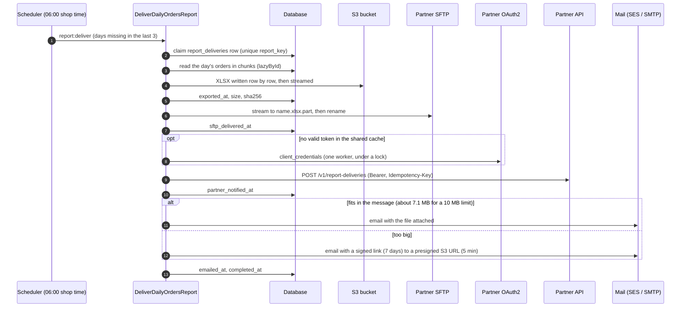

# Laravel Integrations Kit

**English** · [Español](README.es.md)

[](https://github.com/JulianContreras02/laravel-integrations-kit/actions/workflows/ci.yml)

A small, finished Laravel 13 project covering the integration work most business systems end up needing: an OAuth2 API client that survives concurrency, a large Excel export that never loads into memory, an SFTP delivery that is safe to retry, and email that knows when a file is too big to attach.

Everything runs against simulated services in Docker Compose. No real account is needed.


<sub>A real run against the Docker Compose stack, recorded with VHS from [`docs/demo/demo.tape`](docs/demo/demo.tape) (see [Recording the demo](#recording-the-demo)).</sub>

## The problem

An online shop has to send its fulfillment partner a report of the previous day's orders every morning. The partner wants:

1. An **Excel file** in its **SFTP** inbox.
2. A call to its **REST API**, protected with **OAuth2 client credentials**, registering the file and its SHA-256.
3. An **email** to its operations mailbox with the file, or a download link when the file is too big.

This looks simple until the failure cases show up:

- Many workers ask for an OAuth token at the same moment.
- A busy day does not fit in memory.
- The SFTP server drops the connection halfway through an upload.
- A retry sends the same file twice.
- The mail provider rejects a 12 MB attachment.
- The scheduler was down over the weekend.

This repository handles each of those cases and tests each one.

## What it shows

| Piece | How | Code |
|---|---|---|
| OAuth2 client credentials | The token lives in a shared cache until `expires_in − 60 s`. Refreshes run under an atomic lock with a second cache check, so ten workers make one token request. A 401 makes the client drop that token and retry exactly once. | [`ClientCredentialsTokenProvider`](app/Integrations/Partner/OAuth/ClientCredentialsTokenProvider.php), [`PartnerApiClient`](app/Integrations/Partner/PartnerApiClient.php) |
| Large Excel to S3 | Rows are read with keyset pagination and written row by row with OpenSpout, then the file is streamed to S3. Memory use is the same for 1,000 or 1,000,000 orders. | [`DailyOrdersExporter`](app/Reports/DailyOrdersExporter.php) |
| SFTP with retries and idempotency | Upload to `name.part`, then rename. If the file is already there with the same size, nothing happens. A different file with the same name is an error, never overwritten. Short in-process retries handle network blips; queue retries handle outages. | [`SftpDelivery`](app/Delivery/SftpDelivery.php) |
| Size-aware email | The exact base64 MIME size is computed against the SES limit. Above it, the email carries a signed Laravel link instead of the file. The link redirects to a 5-minute presigned S3 URL. | [`AttachmentPolicy`](app/Mail/AttachmentPolicy.php), [`ReportMailer`](app/Mail/ReportMailer.php), [`DownloadReportController`](app/Http/Controllers/DownloadReportController.php) |
| Orchestration | One queued job per business day. Every step records itself in a control table, so a retry resumes where the last attempt stopped. A catch-up window recovers missed days. | [`DeliverDailyOrdersReport`](app/Jobs/DeliverDailyOrdersReport.php), [`report:deliver`](app/Console/Commands/DeliverDailyOrdersReportCommand.php) |

## Flow



If any step fails, the queue retries the job later (after 1, 5 and 15 minutes). The retry skips every step that already has a timestamp, so it works on the same file with the same checksum.

## Run it

You need Docker with Compose. PHP is not needed on the host.

```bash
git clone https://github.com/JulianContreras02/laravel-integrations-kit.git
cd laravel-integrations-kit
cp .env.example .env
```

Install dependencies, generate the key and create the database:

```bash
docker compose run --rm app sh -c "composer install && composer setup"
```

Start the app, the queue worker and the simulated services:

```bash
docker compose up -d --wait
```

Seed three days of demo orders and deliver them:

```bash
docker compose exec app php artisan db:seed
```

```bash
docker compose exec app php artisan report:deliver --sync
```

`report:deliver` without `--date` delivers every day of the last three that has not been delivered yet. `--sync` runs it in the current process; without it, the jobs go to the queue worker.

### What to look at

| Where | What you should see |
|---|---|
| `docker compose exec app php artisan report:status` | One row per day, with the time each step finished |
| Mailpit, <http://localhost:8025> | Three emails with the spreadsheet attached |
| RustFS console, <http://localhost:9001> (`local-access-key` / `local-secret-key`) | The files under `reports/daily-orders/YYYY/MM/` |
| `docker compose exec sftp ls -l /home/partner/inbound` | The same three files, and no `.part` left behind |
| WireMock, <http://localhost:8080/__admin/requests> | **One** token request, then one registration per day with its `Idempotency-Key` |

### Try the failure paths

**Running it again changes nothing:**

```bash
docker compose exec app php artisan report:deliver --sync
```

**A file too big to attach.** Lower the limit for one run and pick any past day:

```bash
docker compose exec -e REPORT_MAIL_MAX_MESSAGE_BYTES=1 app php artisan report:deliver --date=2026-01-15 --sync
```

The email in Mailpit now has a "Download the report" button instead of an attachment. The link goes to the app on port 8000, which redirects to a presigned URL on port 9000. Change one character of the link and you get 403.

A real large day does the same with the default 10 MB limit. With 300,000 orders the 12.2 MB file goes as a link and the whole email weighs 12.5 kB:


**The partner's SFTP server goes down.** Stop it and queue a day:

```bash
docker compose stop sftp
```

```bash
docker compose exec app php artisan report:deliver --date=2026-01-16
```

After about a minute, `report:status` shows the day exported but not delivered, with the error. Start the server again:

```bash
docker compose start sftp
```

The queue retries the job 60 seconds after the failure. It skips the export (same `exported_at`, same checksum) and finishes the remaining steps. Follow it with `docker compose logs -f worker`.

Ports already in use? Change `APP_PORT`, `S3_PORT`, `MAILPIT_PORT` and the others in `.env`, and keep `APP_URL` and `AWS_PUBLIC_ENDPOINT` in line with them.

### Recording the demo

The GIF at the top is recorded with [VHS](https://github.com/charmbracelet/vhs) from [`docs/demo/demo.tape`](docs/demo/demo.tape). The tape types the same `docker compose exec` commands as this README against the running stack, after [`prepare.sh`](docs/demo/prepare.sh) resets it to a known state. With the stack running, from the repository root:

```bash
docker build -t integrations-kit-vhs docs/demo
```

```bash
docker run --rm -v /var/run/docker.sock:/var/run/docker.sock -v "$PWD:/vhs" integrations-kit-vhs docs/demo/demo.tape
```

[`mailpit-screenshot.sh`](docs/demo/mailpit-screenshot.sh) then delivers the 300,000-order day and takes the Mailpit screenshot with the same image's Chromium.

## Tests

| Suite | Command | Needs |
|---|---|---|
| Unit and feature (76 tests) | `docker compose run --rm --no-deps app composer test` | Nothing: HTTP, storage, mail and queue are faked |
| Integration (10 tests) | `docker compose exec app composer test:integration` | The compose services running |
| Lint and static analysis | `docker compose run --rm --no-deps app composer lint`, then `composer analyse` | Nothing |

With PHP 8.4+ and Composer installed locally, `composer install && composer check` runs lint, analysis and the regular suite.

Some tests are worth reading on their own:

- [**Concurrency, with real processes**](tests/Feature/Partner/TokenRefreshConcurrencyTest.php): ten `php artisan partner:token` processes start at once with an empty file cache, against a deliberately slow local token server. The server must have issued exactly one token. With the lock removed, the same test sees ten.
- [**Worst-case memory**](tests/Feature/Reports/DailyOrdersExportMemoryTest.php): exporting 40,000 orders must not use more memory than exporting 2,000. Both peak at about 1.1 MB. Loading the rows with `get()` instead pushes the large export to 43 MB, and the test fails.
- [**Exact MIME size**](tests/Unit/AttachmentPolicyTest.php): the size formula is checked against `chunk_split(base64_encode(...))`.
- [**Resume after failure**](tests/Feature/Reports/DeliverDailyOrdersReportTest.php): SFTP fails, then comes back. The retry reuses the export (same timestamp and checksum) instead of regenerating it.
- [**Integration**](tests/Integration): a real token count in WireMock, a revoked token simulated with a WireMock scenario, presigned URLs validated by RustFS, the real SFTP server, SMTP to Mailpit, and the whole job run twice for one day.

CI runs Pint, Larastan at level max, the suite on PHP 8.4 and 8.5 (coverage at least 90%; it is 98% today) and the integration group against the same Docker Compose services, on every push and pull request.

## Worst-case volume

Before trusting an export in production, run it with the worst day you expect. `report:benchmark` fills a throwaway in-memory database with synthetic orders, exports each volume to the real bucket and cleans up afterwards:

```bash
docker compose exec app php artisan report:benchmark --rows=1000,10000,100000,300000,1000000
```

On Docker Desktop (Windows), with RustFS as S3:

| Orders | Export and upload | PHP peak memory | Used by the export | File size | Email |
|---:|---:|---:|---:|---:|---|
| 1,000 | 0.1 s | 51.1 MB | 1.2 MB | 0.05 MB | attachment |
| 10,000 | 0.4 s | 51.5 MB | 1.1 MB | 0.43 MB | attachment |
| 100,000 | 4.4 s | 54.3 MB | 2.1 MB | 4.36 MB | attachment |
| 300,000 | 18.5 s | 54.3 MB | 2.1 MB | 12.21 MB | signed link |
| 1,000,000 | 108.3 s | 55.2 MB | 3.0 MB | 39.65 MB | signed link |

"Used by the export" is the peak above the process baseline, which is the booted framework. It stays at a few megabytes from 1,000 to 1,000,000 rows. Around 170,000 orders the file outgrows the attachment budget and the email switches to the link on its own.

The database is SQLite in memory, so the time column is a lower bound. Against a networked MySQL, reads take longer, while memory and file size stay the same.

## Design decisions and trade-offs

**Token cache with a lock and a second check, not a cache alone.** A cache by itself still lets every worker refresh at once when the token expires (a cache stampede). The lock lets one worker refresh while the others wait for it and then read the new token.
- The lock TTL (15 s) is longer than the token request timeout (5 s), so a slow refresh is never duplicated.
- Waiting workers give up after 10 s and let the queue retry, instead of piling up.
- On a 401 the client drops the token only if the cache still holds that same token, so a late 401 cannot discard a token another worker has just refreshed.
- *Trade-off:* the cache store must support atomic locks and be shared by every worker. A file cache works on one host. Several hosts, or Lambda, need Redis or DynamoDB.

**OpenSpout, not Laravel Excel.** Laravel Excel is built on PhpSpreadsheet, which keeps every cell object in memory, so memory grows with the number of rows. OpenSpout writes rows to disk as they come, with inline strings, so no shared-strings table grows in memory either.
- *Trade-off:* OpenSpout styling is basic (formats, bold, widths, frozen header), with no formulas or charts. That is enough for a data feed.

**XLSX goes through a local temporary file.** An XLSX file is a zip container, and zips are written to a seekable file. So the workbook is assembled in the temp directory, streamed to S3 with `writeStream` (multipart above 16 MB) and deleted in a `finally` block, even when the upload fails.
- *Trade-off:* the temp disk must hold one file. On Lambda that is `/tmp`, whose ephemeral storage is 512 MB by default and configurable up to 10 GB. CSV could stream straight to S3 without a temp file, but the partner asked for Excel.

**Keyset pagination (`lazyById`), not `OFFSET`.** Offset pages get slower the further they go and can skip or repeat rows if data changes during the export. Keyset pagination stays fast, and the `(placed_at, id)` index serves both the day range and the cursor. Rows are read as plain objects, not Eloquent models, and only with the columns the partner needs: no customer email leaves the shop.

**The business day is in the shop's timezone.** An order placed at 23:30 in Bogotá is stored as 04:30 UTC the next day, and it still belongs to the report of the day it was placed. The query converts the local day to a UTC range, and the spreadsheet shows local times with the timezone in the header.

**`.part` and rename, plus an existence check, for SFTP.**
- The rename is atomic on the server, so the partner's importer never picks up a half-written file.
- Before uploading, the delivery checks the inbox. The same name with the same size means it is already delivered: skip. The same name with a different size is a `RemoteFileConflict`, which fails at once without retries and never overwrites a file the partner may already have imported.
- *Trade-off:* comparing sizes is not comparing content. SFTP has no standard checksum command, so the SHA-256 travels to the partner through the API for them to verify.

**Two levels of retries.** In-process retries (after 1 s and 5 s) absorb a reset connection without making the job wait minutes. Queue retries (after 1, 5 and 15 minutes) cover real outages and resume from the last completed step. Only transport errors are retried, never conflicts.

**A control table, not "the date of the last run".** A run is pending if the day has no completed row, never if it is "after the last execution". A failed or skipped run therefore cannot silently move the window forward. The unique `report_key` (`daily-orders:YYYY-MM-DD`) makes the job idempotent. The step timestamps make retries cheap and the history auditable: what was sent, when, with which checksum, after how many attempts.
- Without `--date`, the command catches up the last three days.
- Older gaps and failed days are not sent automatically. After a long outage a person decides, instead of flooding the partner with a backlog.

**Exactly once is not possible across four systems, so each step is idempotent where it can be:**
- S3 writes to a fixed key.
- SFTP checks before uploading.
- The partner API receives the report key as an `Idempotency-Key`.
- The email is the exception, and it is at least once: a crash right after sending means it is sent again on retry. That is the cheapest duplicate and it is documented rather than hidden.

**The exact encoded size, not "the file size".** SES limits the whole message after base64. With the v1 API (Laravel's `ses` mailer) the limit is 10 MB; with the v2 API (`ses-v2`) or SMTP it is 40 MB. Base64 plus a CRLF every 76 characters grows a file by about 37%. The default limit is 10 MB, read as 10,000,000 bytes, with 256 KB of headroom for headers and body, so attachments go up to about 7.1 MB. The recipient's mail server may accept less than SES, which is another reason the link exists.

**A signed Laravel link in front of a short presigned S3 URL, not a presigned URL in the email.**
- A presigned URL dies when the credentials that signed it expire. With an IAM role, as on Lambda or ECS, that is hours, not the 7 days the email promises.
- A link of our own can be logged on every download and revoked all at once by rotating `APP_KEY`.
- *A detail that matters:* SigV4 signs the host. A URL signed for the internal endpoint (`http://s3:9000` inside Docker) cannot be rewritten to the public one afterwards, and Laravel's `temporary_url` option does exactly that rewrite after signing. A second disk, `reports_public`, therefore signs for the browser-facing host from the start. Signing needs no network call. With real S3 both disks are the same.

**Simulated services.**
- **WireMock** plays the partner's API and its OAuth2 token endpoint. A dedicated mock OAuth server would only issue tokens, while WireMock also counts requests (to prove there is one token request) and runs scenarios (to simulate a revoked token).
- **RustFS** replaces MinIO, which no longer publishes container images. RustFS validates SigV4 like S3, so presigned URLs are really tested.
- **SQLite** keeps the stack small. The queries use nothing SQLite-specific.

## What I would change in production

- **Secrets:** the OAuth client secret and the SFTP private key in AWS Secrets Manager or SSM Parameter Store. S3 through an IAM role, with no keys. SFTP with key authentication and the server's host key fingerprint pinned (`PARTNER_SFTP_HOST_FINGERPRINT`).
- **Shared state:** Redis (ElastiCache) or DynamoDB for the token cache and its lock, encrypting the cached token if the store is shared with other systems. MySQL or Aurora for the data, with the export reading from a replica.
- **Queue and alerting:** SQS with a dead-letter queue. An alarm when a job fails for good, and a "dead man's switch" alarm when no delivery for yesterday has completed by 08:00, because a scheduler that never ran produces no error at all.
- **Observability:** structured logs carrying the `report_key`, plus metrics for duration, rows, file size and attempts per step. Tracing around the partner calls.
- **Storage:** an S3 lifecycle rule to expire reports after the retention period, SSE-KMS encryption, Block Public Access and a bucket policy that denies non-TLS requests.
- **Partner API:** honour `429` and `Retry-After`, and add contract tests against the partner's OpenAPI document.
- **Email:** SES v2 if the partner's mail server accepts larger messages, plus SPF, DKIM and DMARC, and bounce handling. For internal recipients, put the download link behind SSO.
- **Volume:** repeat the benchmark against a production-sized copy of the real table, because real data can behave differently from synthetic data.

## Project layout

```text
app/
  Console/Commands/         report:deliver, report:status, report:benchmark, partner:token
  Delivery/                 SFTP delivery and its result and conflict types
  Http/Controllers/         Signed download link to a presigned S3 URL
  Integrations/Partner/     OAuth2 client credentials and the partner API client
  Jobs/                     The delivery pipeline (one job per business day)
  Mail/                     Attachment policy, mailable and mailer
  Models/                   Order, ReportDelivery (the control table)
  Reports/                  The streaming XLSX exporter
database/seeders/           Demo data and the synthetic bulk generator
docker/                     PHP image and WireMock stubs for the partner
docs/demo/                  VHS tape and scripts behind the GIF and the Mailpit screenshot
tests/
  Feature/  Unit/           Regular suite, fakes only
  Integration/              Against the docker compose services
```

## License

[MIT](LICENSE)
